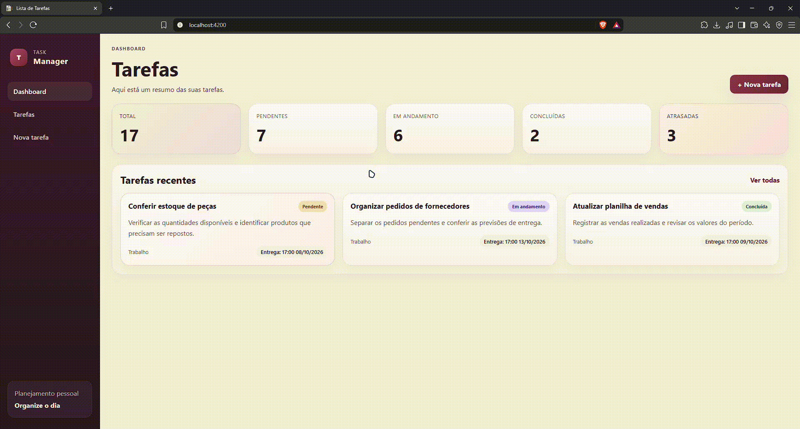

# Task Manager Frontend

A task management web application built with Angular and TypeScript, integrated with a REST API developed using Spring Boot.

The application provides a dashboard and task management interface designed to help organize daily activities, track progress and identify overdue tasks.

**Backend API:** [task-manager-api](https://github.com/junior-2912/task-manager-api)

## Features

* Dashboard with task overview.
* Task listing and visualization.
* Create and edit tasks.
* Update task statuses.
* Delete tasks, subject to backend business rules.
* Search and filter tasks.
* Display task categories, statuses and due dates.
* Identify overdue tasks.
* Responsive interface for different screen sizes.

## Demo

Check out the Task Manager in action:


## Technologies

* **Angular 22**
* **TypeScript**
* **HTML5**
* **CSS3**
* **Angular Router**
* **Angular Forms**
* **Angular HttpClient**
* **RxJS**
* **npm**

## Application Structure

The application uses Angular standalone components and organizes its main screens through routing.

| Route             | Description           |
| ----------------- | --------------------- |
| `/`               | Dashboard             |
| `/tasks`          | Task listing          |
| `/tasks/new`      | Create a task         |
| `/tasks/:id/edit` | Edit an existing task |

The frontend communicates with the backend through HTTP requests. Task data is retrieved and persisted by the REST API rather than being stored exclusively in the browser.

## Getting Started

### Prerequisites

Make sure you have installed:

* Node.js compatible with the installed Angular version.
* npm.
* Git.
* The [Task Manager API](https://github.com/junior-2912/task-manager-api) running locally.

### 1. Clone the repository

```bash
git clone https://github.com/junior-2912/taskmanager-frontend.git
cd taskmanager-frontend
```

### 2. Install dependencies

```bash
npm install
```

### 3. Configure the backend URL

Make sure the frontend's HTTP service points to the running backend API.

For local development, the backend base URL is expected to be:

```text
http://localhost:8080
```

If the backend is running on a different host or port, update the API URL in the frontend configuration.

The backend must also allow requests from the frontend origin through its CORS configuration.

### 4. Start the development server

```bash
npm start
```

Open the application at:

`http://localhost:4200`

The development server supports live reloading when source files change.

## Build

To generate a production build:

```bash
npm run build
```

The generated build artifacts are placed in the `dist/` directory.

## Tests

To run the configured frontend tests:

```bash
npm test
```

## Related Project

Backend API: [junior-2912/task-manager-api](https://github.com/junior-2912/task-manager-api)

## Author

Developed by Junior ([junior-2912](https://github.com/junior-2912)) as part of a personal full-stack learning project focused on integrating an Angular frontend with a Java and Spring Boot REST API.
